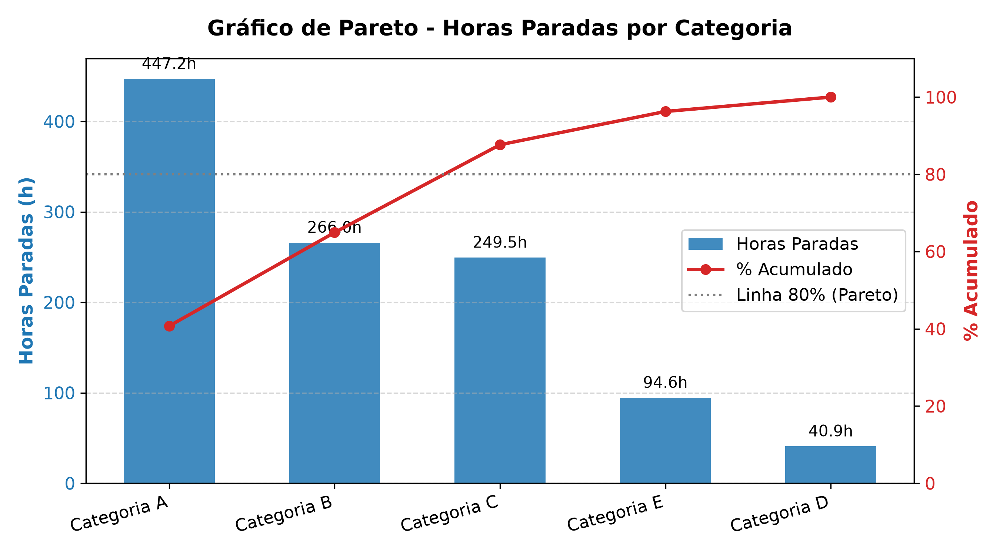
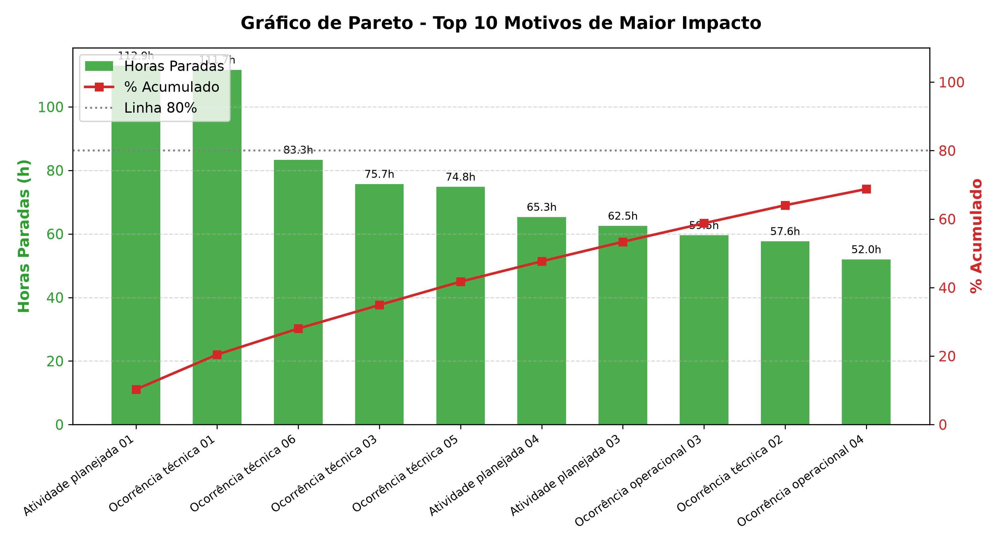
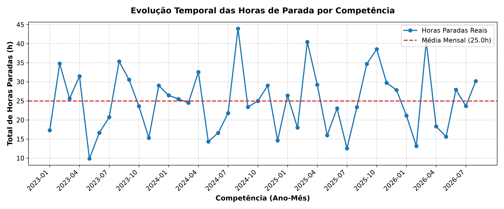
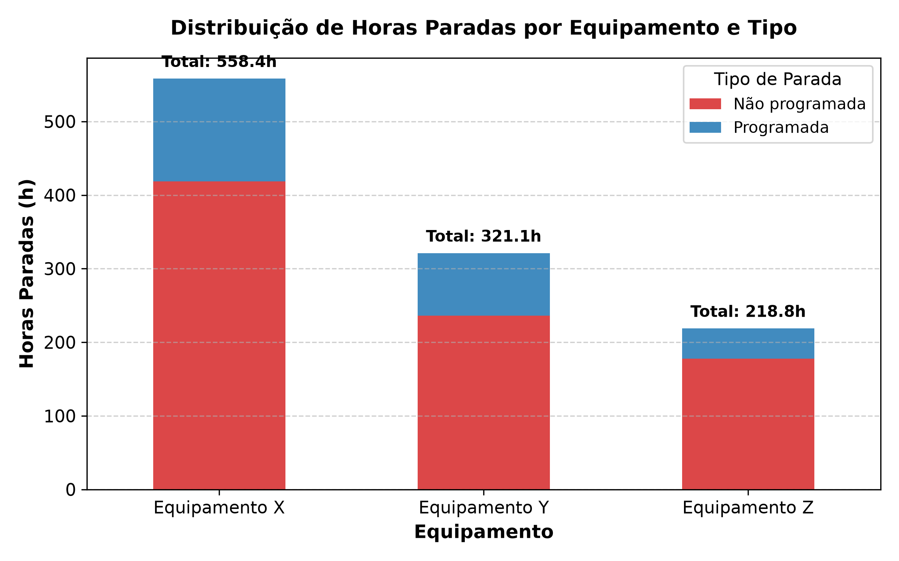
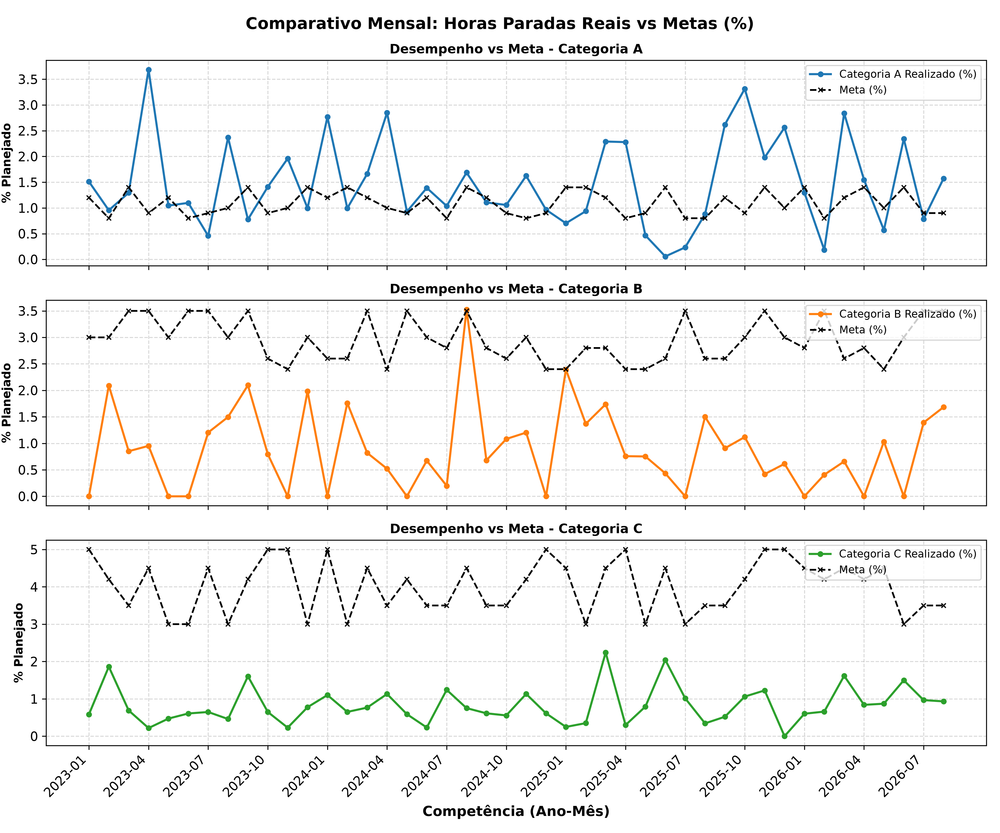

# Relatório de Análise de Horas Improdutivas de Máquinas

## 1. Resumo Executivo
Este relatório apresenta o diagnóstico aprofundado das paradas de máquinas registradas na operação, com base nos registros históricos de paradas (`dados/paradas_maquina.csv`) e no planejamento operacional mensal (`dados/metas_e_horas_planejadas.csv`).

- **Período avaliado:** 02/01/2023 a 31/08/2026 (44 competências mensais analisadas).
- **Total de eventos de parada:** 559 ocorrências.
- **Volume total de horas paradas:** 1098.25 horas.
- **Volume total de horas planejadas:** 30429.60 horas.
- **Taxa global de indisponibilidade:** 3.61% do tempo planejado.
- **Principal categoria geradora de perdas:** **Categoria A**, respondendo por 447.21h (40.72% das horas paradas).
- **Principal motivo de parada:** **Atividade planejada 01**, responsável por 112.93h (10.28% do tempo parado).

---

## 2. Qualidade e Limitações dos Dados
A integridade dos arquivos foi checada de ponta a ponta:
- Não foram identificados dados ausentes (nulos), chaves duplicadas ou durações inconsistentes/negativas.
- Todos os registros temporais foram validados e convertidos com consistência.
- O relatório detalhado com evidências quantitativas está documentado em [`qualidade.md`](qualidade.md).

> [!NOTE] Limitação da Análise
> Os dados não informam custos de manutenção por hora nem perda monetária de produto. Portanto, a análise prioriza o impacto físico em horas de indisponibilidade e aderência às metas percentuais contratadas.

---

## 3. Indicadores Calculados e Fórmulas

As fórmulas adotadas seguiram rigorosamente as regras da skill `analise-tempo`:

1. **Horas Totais de Parada:** Soma de todas as durações registradas (`Duracao_horas`).
2. **Participação Percentual por Categoria ou Motivo (%):** `(Horas do item / Total geral de horas paradas) * 100`.
3. **Taxa Real Mensal por Categoria (%):** `(Horas da categoria no mês / Horas planejadas no mês) * 100`.
4. **Desvio em Relação à Meta (p.p.):** `Taxa Real Mensal (%) - Meta (%)`.
   *(Valores positivos indicam estouro da meta; valores negativos indicam operação dentro do limite).*

---

## 4. Principais Categorias e Motivos de Parada (Análise de Pareto)

### 4.1. Distribuição por Categoria
Abaixo está a distribuição ordenada de horas e a participação acumulada:

| Categoria | Total Horas (h) | Ocorrências | % do Total | % Acumulado |
| :--- | :---: | :---: | :---: | :---: |
| Categoria A | 447.21 | 180 | 40.72% | 40.72% |
| Categoria B | 266.04 | 57 | 24.22% | 64.94% |
| Categoria C | 249.49 | 196 | 22.72% | 87.66% |
| Categoria E | 94.58 | 84 | 8.61% | 96.27% |
| Categoria D | 40.93 | 42 | 3.73% | 100.00% |

### 4.2. Top 10 Motivos com Maior Impacto
Os 10 motivos mais críticos representam a maior parte das horas perdidas da operação:

| Motivo | Categoria | Total Horas (h) | Ocorrências | % do Total | % Acumulado |
| :--- | :--- | :---: | :---: | :---: | :---: |
| Atividade planejada 01 | Categoria B | 112.93 | 22 | 10.28% | 10.28% |
| Ocorrência técnica 01 | Categoria A | 111.65 | 39 | 10.17% | 20.45% |
| Ocorrência técnica 06 | Categoria A | 83.30 | 37 | 7.58% | 28.03% |
| Ocorrência técnica 03 | Categoria A | 75.68 | 27 | 6.89% | 34.92% |
| Ocorrência técnica 05 | Categoria A | 74.79 | 30 | 6.81% | 41.73% |
| Atividade planejada 04 | Categoria B | 65.30 | 14 | 5.95% | 47.68% |
| Atividade planejada 03 | Categoria B | 62.50 | 14 | 5.69% | 53.37% |
| Ocorrência operacional 03 | Categoria C | 59.55 | 39 | 5.42% | 58.79% |
| Ocorrência técnica 02 | Categoria A | 57.65 | 27 | 5.25% | 64.04% |
| Ocorrência operacional 04 | Categoria C | 51.95 | 41 | 4.73% | 68.77% |

---

## 5. Gráficos e Tendências Identificadas

### 5.1. Análise de Pareto (Categorias e Motivos)
Os gráficos de Pareto evidenciam a concentração de horas improdutivas:
- As duas primeiras categorias concentram mais de **64.9%** de todo o tempo de parada da fábrica.
- Visualização de Pareto por Categoria: 
- Visualização de Pareto por Motivo: 

### 5.2. Evolução Temporal das Paradas
- O histórico temporal demonstra a flutuação do total de horas paradas mês a mês, orbitando em torno da média de **24.96h** mensais.
- Visualização da Série Temporal: 

### 5.3. Distribuição por Equipamento e Tipo de Parada
- Comparativo entre paradas programadas e não programadas por máquina:

| Equipamento | Não Programada (h) | Programada (h) | Total Parado (h) | % Total |
| :--- | :---: | :---: | :---: | :---: |
| Equipamento X | 418.51 | 139.86 | 558.37 | 50.84% |
| Equipamento Y | 235.93 | 85.16 | 321.09 | 29.24% |
| Equipamento Z | 177.77 | 41.02 | 218.79 | 19.92% |

- Gráfico por Equipamento: 

---

## 6. Desvios em Relação às Metas Disponíveis

As metas contratuais estão definidas exclusivamente para as Categorias A, B e C:

| Indicador / Categoria | Média da Meta Estabelecida | Média Real Observada | Desvio Médio Pontual | Meses Acima da Meta | Status Geral |
| :--- | :---: | :---: | :---: | :---: | :---: |
| **Categoria A** | 1.09% | 1.48% | +0.39% | 28 de 44 meses (63.6%) | ⚠️ Atenção |
| **Categoria B** | 2.95% | 0.89% | -2.06% | 1 de 44 meses (2.3%) | ✅ Conforme |
| **Categoria C** | 4.01% | 0.83% | -3.18% | 0 de 44 meses (0.0%) | ✅ Conforme |

- Gráfico comparativo mês a mês: 

---

## 7. Perguntas para Investigação e Recomendações

### 7.1. Fatos Observados (Comprovados pelos Dados)
1. As paradas da **Categoria A** e **Categoria B** lideram o volume de indisponibilidade física.
2. O motivo **Atividade planejada 01** gerou o maior impacto isolado em horas paradas (112.93h).
3. O equipamento com maior tempo de parada acumulado foi o **Equipamento X**.

### 7.2. Perguntas para Investigação da Engenharia e Operação
1. **Padrão de Falhas:** Quais subcomponentes ou partes de desgaste estão associados ao motivo *Atividade planejada 01*?
2. **Eficiência de Intervenção:** O tempo elevado de certas paradas decorre de demora no diagnóstico, indisponibilidade de peças de reposição ou falta de especialização do time de manutenção de turno?
3. **Planejamento vs Execução:** Para paradas programadas, o tempo de execução real tem sido aderente à janela planejada pela engenharia de processos?

### 7.3. Recomendações Baseadas em Evidências
- **Ação Imediata no Pareto:** Criar um comitê Kaizen focado nos 3 motivos de topo (*Atividade planejada 01*, *Ocorrência técnica 01* e *Ocorrência técnica 06*), responsáveis por grande parte das perdas operacionais.
- **Revisão de Metas e Alertas:** Implementar monitoramento semanal para as categorias que ultrapassaram a meta com maior frequência, gerando avisos automáticos antes do fechamento do mês.
- **Plano Preventivo por Equipamento:** Intensificar planos de manutenção preditiva e preventiva no **Equipamento X**, que apresentou a maior concentração de horas paradas.
